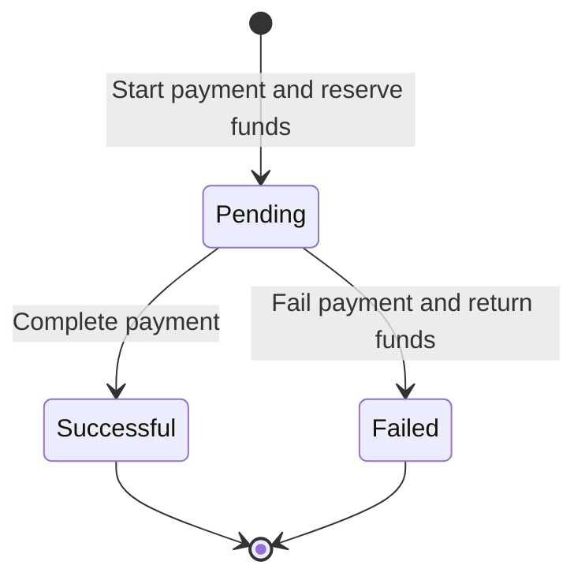

# Test plan

## Objective and scope

Verify sign-in, wallet top-up, wallet-to-wallet transfer, simulated merchant payment, and account-specific transaction history in Demo v1.0. For money movements, compare the displayed balance and history with the transaction outcome. The demo uses session-only data and fixed test accounts. External gateways, account registration, and persistence across restarts are outside this test scope.

## Environment and test data

Baseline execution used Python 3.13.9 and Tk 8.6 on Windows. Each case starts from a fresh offline app session. Alice begins with ₹500 and Bob with ₹100. Both use the demo password `demo123`. The username `unknown` is absent. The demo supports positive whole-rupee amounts.

| Feature | Expected behavior |
|---|---|
| Sign-in | Known account and correct password open the wallet. Invalid credentials show an error. |
| Top-up | The inclusive limit is ₹10 to ₹5,000 per top-up. A successful top-up increases the balance and records a successful entry. |
| Transfer | A positive amount up to the available balance can be sent to another existing wallet without a fee. Rejection leaves balances and history unchanged. Recipient validation runs before the balance check. |
| Payment | Starting a payment reserves the amount and creates a Pending entry. Completing it retains the deduction. Failing it restores the reserved amount. A finalized payment cannot be finalized again. |
| History | Entries display reference, type, sender, recipient, amount, and status, with newest entries first. Transfers appear for both parties. |

## Execution

Design cases with equivalence partitioning, boundary value analysis, a decision table, and state transitions. Execute the UI cases against a fresh session, then run Python unit tests for wallet rules. Document failures with the build, steps, balance, transaction reference, and evidence. The defect reporting exercise uses a deliberately faulty variant alongside the regular app.

Before a team rerun, assign one person to setup and execution, one to case and evidence review, and one to presentation. One person can take several roles.

## White box and API scope

Inspect the Wallet source and exercise the true and false outcomes of its direct decisions. Test the local HTTP interface by comparing status codes, JSON and wallet state with expected results. Start each case with fresh data. Use the aggregate runner to repeat all four suites. See the [extended case design](../02_Test_Case_Design/Extended_Test_Design.md).

## Completion criteria

Every planned baseline case has a recorded outcome. Each observed baseline failure has a defect reference or an explanation, and each blocked case identifies its dependency. The unit run, summary, screenshots, and any defect evidence are available from the repository.
